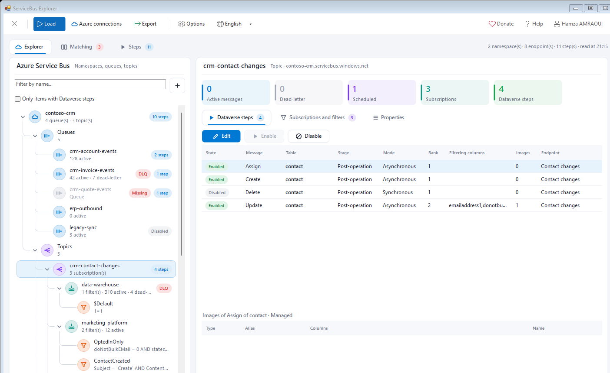
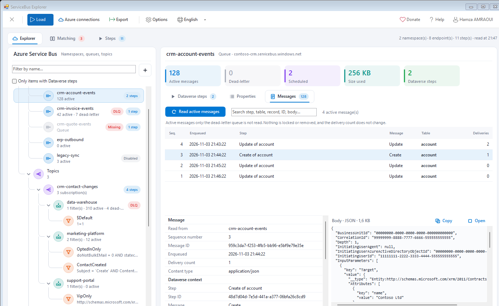
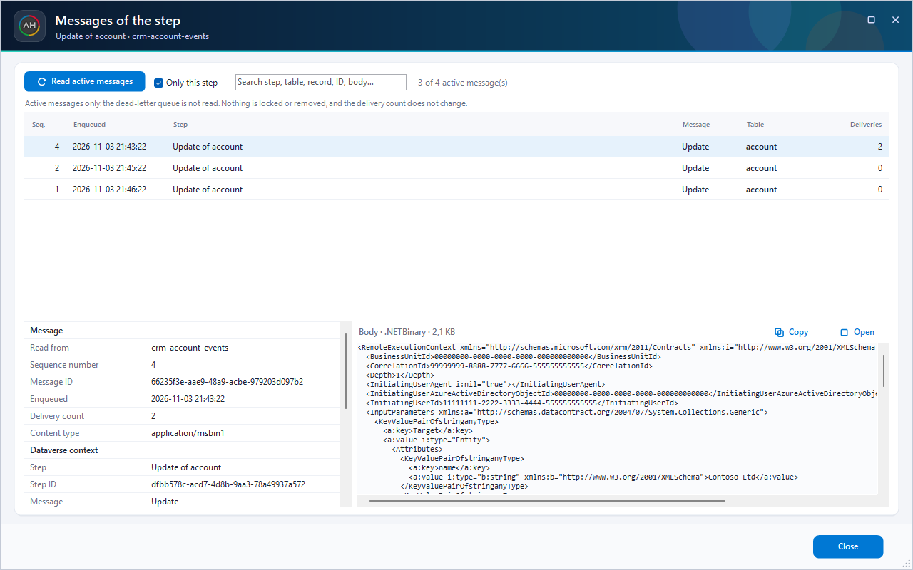
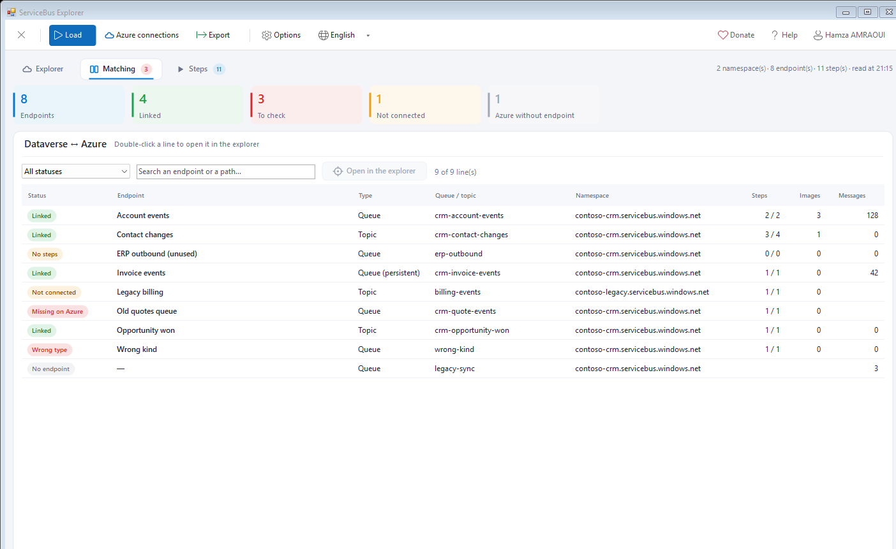
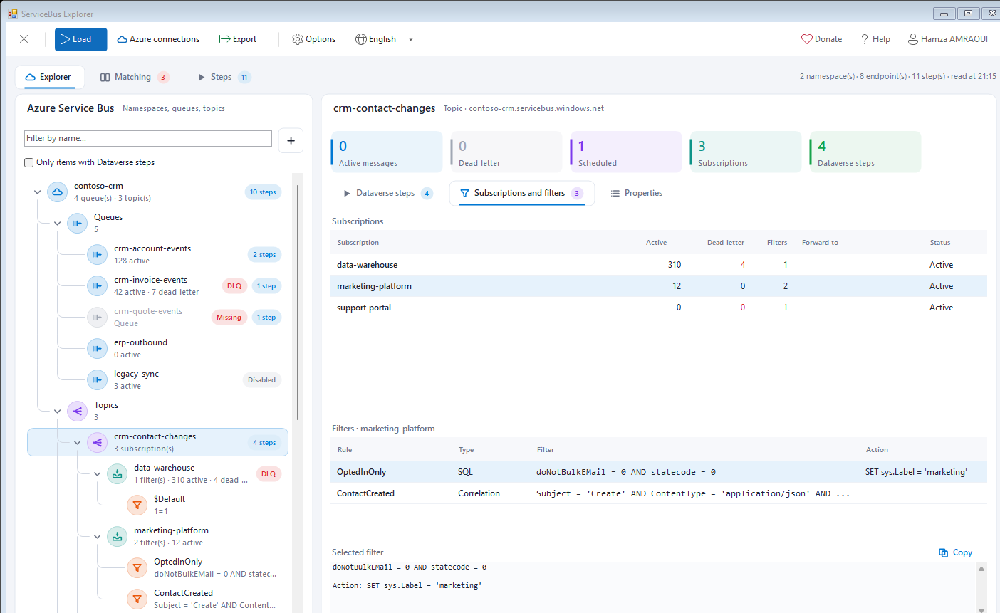
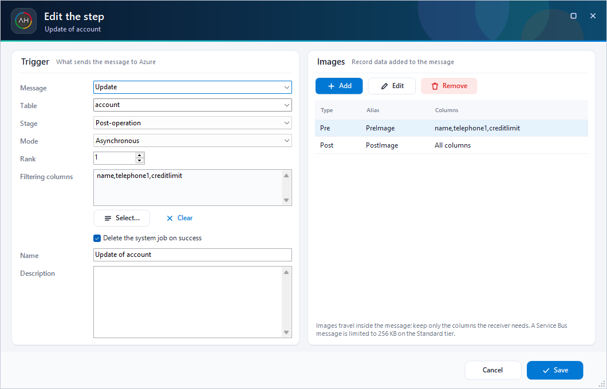

# ServiceBus Explorer (XrmToolBox plugin)

See your **Azure Service Bus** queues, topics, subscriptions and filters directly in XrmToolBox, next to the **Dataverse steps** that send messages to them:

- Which steps publish to this queue or this topic?
- Does every service endpoint still point to something that exists on Azure?
- What is filtered by this subscription, and how many messages are in dead-letter?
- How do I change the trigger or the images of a step without opening the Plugin Registration Tool?
- Which messages did this step send that are still waiting in the queue?



*Explorer with sample data: a topic, its message counters and the Dataverse steps that publish to it.*

---

## Features

| Page | What it does |
|---|---|
| **Explorer** | Tree of the namespaces with their queues, topics, subscriptions and rules, the message counters and a dead-letter marker. For the selected item: the **Dataverse steps** that send to it, its **subscriptions and filters** (SQL and correlation filters, rule actions) and its **properties**. A subscription shows the steps of its topic, because they feed it. |
| **Matching** | Every service endpoint and every Azure entity with a status: *Linked*, *No steps*, *Missing on Azure*, *Wrong type* (for example a Topic endpoint on a queue), *Not connected*, *No endpoint*. Endpoint paths are compared like Service Bus does, without case. Double-click a line to open it in the explorer. Relay, webhook and event hub endpoints are listed under *Other type*. |
| **Steps** | Every step bound to a service endpoint, with search and bulk **enable / disable**. |
| **Step editor** | Edit the **trigger** (message, table, stage, mode, rank, filtering columns, deletion of the system job) and the **images** (pre, post, alias, columns) with a searchable column picker. Registration rules are checked while you type, and every change is summarized for review before it is written. Only the changed attributes are sent. Managed steps that are not customizable are read-only. |
| **Messages** | The **Messages** tab of a queue, topic or subscription, and the **Messages** button of the steps, peek the **active messages** waiting (the dead-letter queue is not read). Each message is linked to the **step that sent it** (the `OwningExtension` of its Dataverse context), whatever the format of the endpoint: JSON, XML or .NETBinary. The detail shows the Service Bus properties, the Dataverse context (message, table, record, user, stage, depth) and the body. A topic is read through its subscriptions. |
| **Excel report** | One `.xlsx` workbook with the matching, the steps, the images, the entities, the subscriptions and the filters. |

The tool **only reads Azure**: it never changes a queue, a topic, a filter or a message. Messages are *peeked*: they are not locked or removed, and their delivery count does not change. A message already taken by a consumer is no longer visible. It only writes steps and step images in Dataverse.

Long operations run behind a loading overlay showing the current step and the elapsed time. **Stop** (or Esc) cancels them. A namespace that cannot be read does not stop the others, and its steps stay available.

The interface is in English and French (header ▸ language). The tool is a single DLL with no dependency other than XrmToolBox. The AMQP engine of the Azure SDK (`Microsoft.Azure.Amqp`), used to peek the messages, is merged into it at build time by ILRepack, with its types made internal so it never clashes with another tool.











---

## Usage

1. Connect to your organization, open the tool and click **Azure connections**.
2. Add your namespaces:

   | Method | Needs | Notes |
   |---|---|---|
   | **Connection string** | A namespace-level key with the **Manage** right | Encrypted for your Windows account (DPAPI) in the settings of the tool. |
   | **Microsoft account** (browser) | The **Reader** role on the namespace | No key needed. Tokens stay in memory and are never saved. |
   | **Azure CLI** | `az login`, and the **Reader** role | Uses the token of the local CLI. |

   Reading the **messages** needs a little more: the **Listen** right for a key (Manage includes it), or the **Azure Service Bus Data Receiver** role for a Microsoft account (Reader and Owner are not enough). The messages are read over AMQP on port 5671, or AMQP over WebSockets on 443 when 5671 is blocked.

3. Click **Load**. Nothing is read before that. Messages are only read when you click **Read active messages** or **Messages**.

Without any Azure connection, **Load** still shows the namespaces used by the Dataverse endpoints, greyed out, with their steps. **Connect** opens the connection popup for that namespace.

### Options

| Option | Use |
|---|---|
| Parallel Azure requests | Requests used to read subscriptions and filters (6 by default). Lower it if Azure limits the requests. |
| Active messages read per queue | Oldest first, for each queue or subscription (100 by default, up to 5,000). The dead-letter queue is not read. |
| Microsoft Entra tenant | Sign in to a specific tenant. Empty means the tenant of your account. |
| Application (client) ID | The browser sign-in uses the public client of the Azure CLI by default. If your tenant blocks it, register a public client with the redirect URI `http://localhost` and the *Azure Service Management* permission, and enter its ID here. |

---

## Privileges

| Action | Dataverse privileges |
|---|---|
| Read | Read on Service Endpoint, Sdk Message Processing Step, Sdk Message Processing Step Image, Sdk Message, Sdk Message Filter |
| Edit | Write on Sdk Message Processing Step; Create, Write and Delete on Sdk Message Processing Step Image |

---

## Build and tests

```powershell
dotnet build "ServiceBus Explorer/ServiceBus Explorer.csproj"     # Debug copies the DLL to the XrmToolBox Plugins folder
dotnet run --project tests/ServiceBusExplorer.Tests               # logic tests
dotnet run --project tests/ServiceBusExplorer.Tests -- --ui             # end-to-end campaign: real mouse and keyboard messages on every screen
dotnet run --project tests/ServiceBusExplorer.Tests -- --screens out    # drives the real UI and saves screenshots
dotnet run --project tests/ServiceBusExplorer.Tests -- --mef            # discovers the plugin like XrmToolBox does
dotnet run --project tests/ServiceBusExplorer.Tests -- --real <org url> # read-only calls on a real organization (uses az login)
dotnet run --project tests/ServiceBusExplorer.Tests -- --emulator       # AMQP peek against the Service Bus emulator (docker)
```

`--emulator` sends messages the way Dataverse does (the three formats), dead-letters one and abandons another, then peeks twice (the reader itself can peek a dead-letter queue, the tool does not use it). It expects the [Service Bus emulator](https://github.com/Azure/azure-service-bus-emulator-installer) on `localhost` with the queue `dataverse-queue` and the topic `dataverse-topic` (subscriptions `all` and `accounts`, the latter filtered on `[http://schemas.microsoft.com/xrm/2011/Claims/EntityLogicalName] = 'account'`).

`--ui` keeps its window on top for a few minutes: leave the computer alone while it runs. Set `SBX_LANG=fr` to run it in French.

The tests use a local HTTP server that answers like a namespace and an in-memory organization. `UseDevelopmentEmulator=true` is supported in connection strings, so the tool can also read the Service Bus emulator.

Developed by [Hamza AMRAOUI](https://www.linkedin.com/in/hamza-amraoui/).
